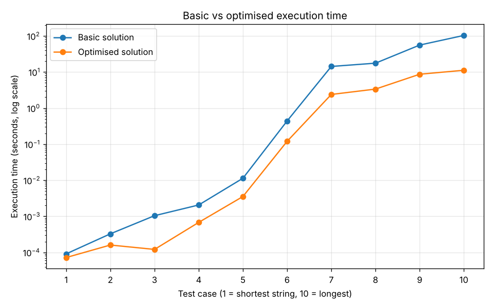

# Binary String Prime Extractor

A Python program that finds every unique prime number hidden in a binary string. It checks every substring, converts it to decimal and keeps the primes below a limit N, then reports how many were found along with the three smallest and three largest.

Built for a data structures and algorithms module at the University of Greenwich. I was **group leader** of a team of four. This repository contains **my basic solution and my optimised version of it**.

## Example

Input: `"0100001101001111"`, N = 999999

Output: `15: [2, 3, 5, 269, 2153, 17231]`, so 15 unique primes, showing the three smallest and three largest.

Strings containing anything other than 0s and 1s return `0: INVALID BINARY STRING`.

## The optimisation

| | Basic solution | Optimised solution |
|---|---|---|
| Primality test | Trial division by every number up to √n | Rules out multiples of 2 and 3, then only tests divisors of the form 6k ± 1 |
| Substring loop | Checks every substring | Stops extending a substring as soon as its value exceeds N, since adding bits only makes it larger |
| Repeated values | Rechecks values that appear in several substrings | Keeps a `seen` set, so each value is tested only once |

Both versions give identical results on all test cases.

## Results

On the 10 given test cases (binary strings of 16 to 96 bits), the optimised version was faster every time. On the largest case it took **11.2 seconds instead of 103.2 seconds, about 9x faster**.

| Test case | String length (bits) | Basic (s) | Optimised (s) |
|---|---|---|---|
| 1 | 16 | 0.0001 | 0.0001 |
| 6 | 64 | 0.44 | 0.12 |
| 7 | 72 | 14.2 | 2.4 |
| 9 | 88 | 55.8 | 8.7 |
| 10 | 96 | 103.2 | 11.2 |



Times were recorded on my machine and will vary on others.

## Complexity

A string of length n has O(n²) substrings, and converting each one costs up to O(n), so generating and converting all substrings is O(n³) before any primality testing. Trial division up to √v costs O(√v) per value v. The optimisations don't change the worst-case complexity, but they skip a large share of the work in practice: about two-thirds of the divisor checks, every substring after its value passes N, and every repeated value.

## Running the code

No extra libraries are needed, just Python 3.

```bash
python basic_solution.py
python optimised_solution.py
```

Each script runs the 10 given test cases (the basic one also runs a small warm-up example first) and prints the results and execution times. The largest cases take a while, especially for the basic solution.
